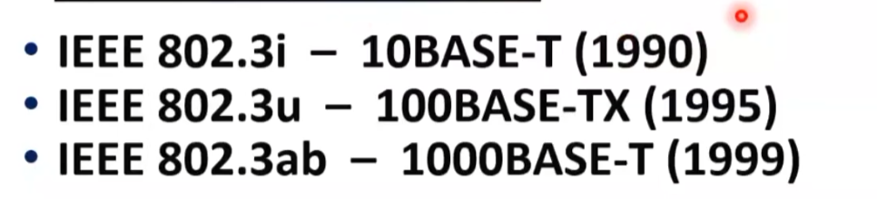
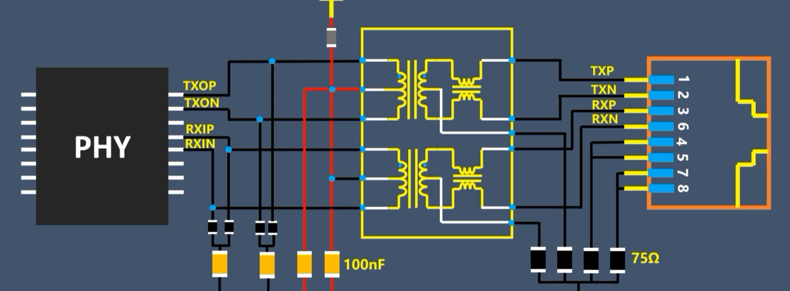
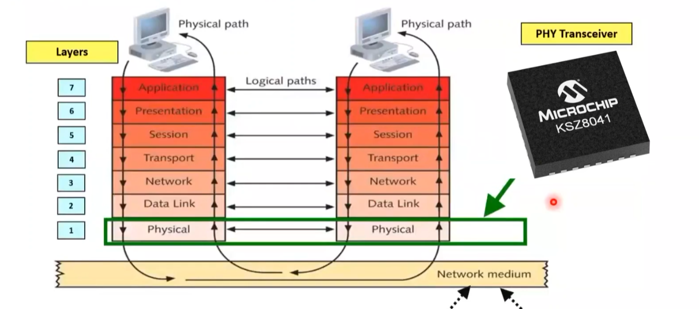
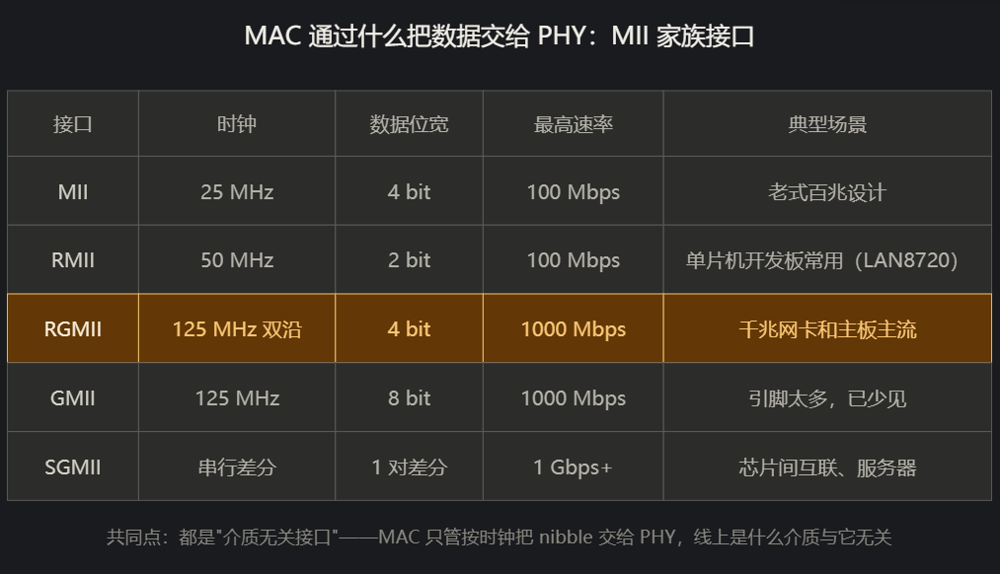
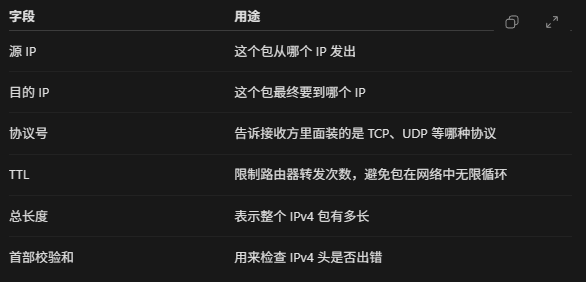
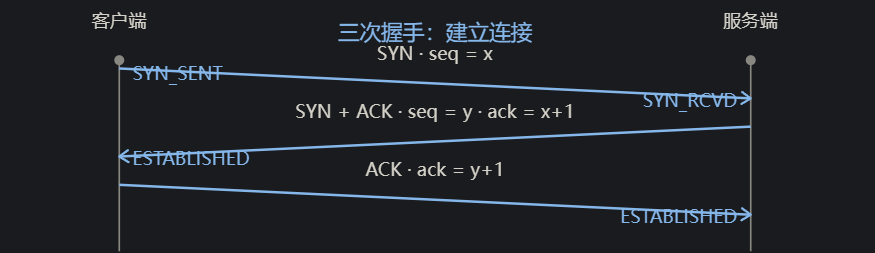
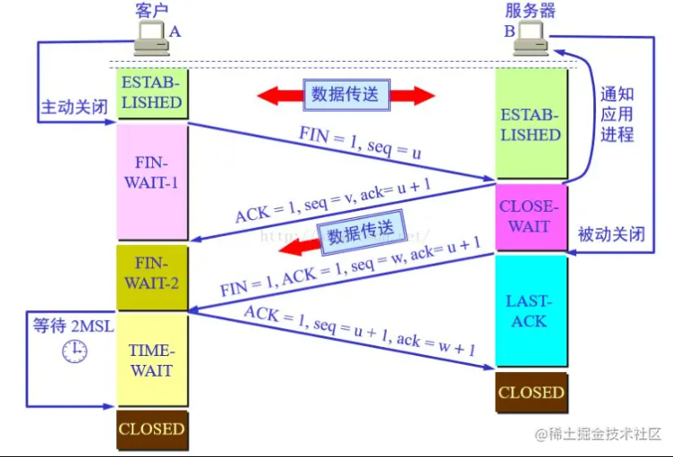
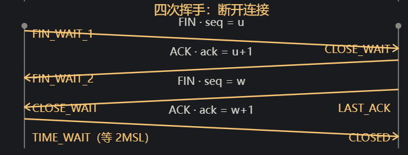
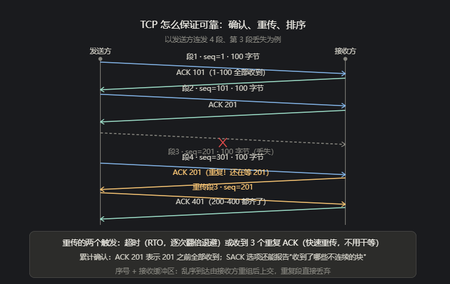

# 网口phy

### **网线**：

网口现在用的比较多的都是百兆或者千兆了，百兆为两对差分对，千兆为4对差分对信号，总共八根

phy和网线之间会走一个**隔离变压器**，phy这一端的电流产生变化，产生磁场的变化就会作用到网线端，就会感应出相对应的电压信号



网络变压器可以隔离网线和phy芯片，能够一定程度上隔绝外界干扰，增强信号，下图为*电压型百兆电路图*



一般来说还有POE通过网口供电的这种东西，这个到时候有时间再说一下

------


### **PHY** 以太网物理层芯片

这个缩写很像物理层，PHY一般指的是实现物理层通讯的**芯片**，可以看成是他把MAC传给他的数字信号转化为电信号，以及把电信号转化为数字信号再回回去的这么一个芯片，属于物理层，



所以说以上的网线加PHY就是基本包含了整个物理层的作用了

第一点就是把MAC层的数字信号和电信号进行相互转换
第二就是在设备之间提供稳定的链路让这个电信号进行传输
第三就是提供电信号给其他设备

以及一些什么工作呢，速度协议自动协商，链路的检测，基本都是phy在做

------


### MAC Media Access Control  介质访问控制？

嵌入式里面一般都是MCU内置的MAC，外挂一个PHY的芯片，所以MAC并不是常说的网卡，像一般外置的PCIE网卡，一张网卡里面除了PCIE的段点还会包含这个网卡的MAC和PHY，

MAC的数据是通过DMA从内存拿的，这个数据又是从哪来的呢，是从TCP/UDP协议栈、IP协议栈包装完了之后来的。所以MAC到这里还是独立的硬件，再往上就是CPU和软件的东西了。

MAC网卡的MAC地址有全球唯一性，出厂时写入网卡地址，长度为48位， 6字节

假设现在在RAM的IP包是**[IP包] [TCP头] [应用数据]**

封装后：**[目的MAC] [源MAC] [类型]** [IP包] **[FCS校验码]**

增加的东西有什么用呢

**目的MAC**：也就是接收方的MAC地址，这一帧要交给哪个接口

**源MAC**：在目的MAC后面，表面发送方的MAC

**类型EtherType**：在源地址的后面，告诉协议的编号，ex IPV4 IPV6，表示后面装的都是IPV4或者IPV6的包

**FCS校验码**：根据帧的内容计算CRC32，再贴在末尾

一句话说明：**MAC 地址主要用于局域网内识别网卡、交换机转发、ARP 解析、DHCP/准入识别和网络管理；它不是用来跨互联网路由的，也可以被伪造**

------


#### MAC和PHY通讯

MAC一般通过MII，RMII，RGMII等接口与PHY进行通讯，MII，RMII最高速率为百兆。RGMII和GMII为千兆，SGMII最高到1Gbps

这些都是真实的电信号



MAC地址不重复到底有什么用：能供让以太网明确判断，这一帧应该给当前链路上的哪个接口？
发送前如何知道目的MAC：这个就是网络层ARP需要学习的东西了
有了MAC地址为什么还要有IP地址：MAC地址只在局域网内起作用，**可以理解成给下一个人**，但是他不是最终的人，**目的IP地址是最终的人**

------


### 网络层

MAC再往上走就是网络层了，主要就是IP包，IP地址，**TCP、UDP是传输层的协议**

假设有一个数据经过了传输层来到了网络层

```
[TCP头][hello]
```

那么加上IP头之后数据就会变成如下

```
[IP头][TCP头][hello]
```

也就是这个TCP 和hello都是他承载的东西

IP头里面有几个比较重要东西，其中第一个肯定就是IP地址，IP地址又有源IP和目的IP，在上面也讲了，**目的IP是终点**，还有协议号，用于告诉接收方里面是UDP还是TCP（类似MAC层中的类型号，标注IPV4还是IPV6的，如果是IPV4，那接下来的IP头后面的数据就按IPV4解析，类似）

以及TTL（限制转发次数），和总长度，还有首部校验和

**问题1**：有了FCS为什么还要有首部校验和
	FCS是保护整个链路上的帧，IPV4首部校验和是保护IP头的，并且**FCS每次经过一次路由器都会重新进行FCS封装**，并不能保证在传输过程中IP包没有出错，目前IPV6已经取消了首部校验和，依靠链路层和上层的其它机制进行错误检测



IP包准备好了之后交给数据链路层，再投入RAM，MAC取走进行封装

**网络层简单说就是把当前链路上的通信，扩展到不同网络之间**，网络层是一组功能，CPU和路由器都实现了功能，**数据链路层的MAC只能在当前网络中使用**

核心作用：
逻辑寻址：		使用IP地址，表示数据从哪来到哪去
路由选择：		根据IP查询路由表，确定从哪发送的，和下一跳去哪
分组转发：		路由器将收到的IP包发送到下一跳，让数据逐段到达目标网络
IP包的封装和解析：发送的时候给上层数据添加IP包发到下一跳，接收时解析IP头，将载荷给到上面的网络
差错报告和网络诊断：	通过ICMP等协议报告目标不可达，TTL耗尽，并支持ping等诊断工具

------


### 传输层

物理层（网线加phy），数据链路层（MAC），网络层（IP）讲的差不多了现在就是传输层了，传输层主要是看TCP和UDP这两个东西

为什么数据包还要分TCP、UDP：有些数据需要完整，有序所以选择TCP，有一些数据更关注及时处理，比如实时的语音和视频，是否需要重传补发由应用决定

假设有个元数据是

```
[hello]
```

那么传输层会在元数据前面加上一个TCP头（以TCP为例）这个头包含什么信息呢

```
[TCP头：源端口，目的端口，序号等]
```

**没错端口号是传输层的概念**

简单讲解之后后面才是重点，主要是围绕TCP和UDP的东西

#### TCP和UDP的区别

##### **1、字节流VS数据报**

​	TCP是字节流，发送A、B、C三个字母对端可能一次read就读到ABC（粘包），也有可能先read到AB，再read到C，**因为TCP只管把数据送到，他并不知道你的消息边界**，也就是不知道一帧数据哪里是头哪里是尾巴，这里就需要应用层来定义边界
​	UDP是数据报，发一个100字节的数据包，他要么收到要么全丢，边界天然就是保留的，发一帧就是一帧

##### **2、端口号**

​	TCP和UDP的端口相互独立，例如同一个8080的端口他可以同时被TCP和UDP占用，二者不冲突，应用程序是看“**IP+端口+协议**”来看是不是冲突了，这三个都一样那肯定冲突

##### **3、是否建立连接**

​	TCP需要进行三次握手和四次挥手

###### 3.1、三次握手：


**为了方便记录客户端用A代替，服务器用字母B代替**，establish（v,建立)

3.1.1、A到B，请求连接，SYN_SEND
	A向B进行连接并告诉自己的起始序号，**其中SYN表示我要和你同步序号**，想和你连接了，seq就是序号是多少

3.1.2、B确认A的请求，同时告诉A自己的序号，SYN_RCVD
	其实可以拆成两步，反正都要建立连接所以**B也会向A发送SYN**，表示我要和你同步序号，同样B也会把自己的seq发过去，第二步就是同意A的请求，**所以会回复一个ACK，因为有消息传输所以序列号加一回复ack=x+1，**

3.1.3、A确认B的同步消息
	这里也就是A确认3.2中B第一步发送的请求，参照第二步所以A也会回应一个ACK，并且有消息发送了所以序列号加一回复一个ack=y+1


###### 3.2四次挥手：





3.2.1、A发出FIN，结束A→B的发送方向，**FIN_WAIT_1**
	FIN表示我在这个方向上没有更多数据要发送了，并且会发送seq，只要是发送消息都会带上自己seq，回应的时候对方在ack上+1回回来，**A发送了FIN到B之后任然可以接收B发来的数据**，这种一个方向结束另一个还能继续传输的状态叫做**半关闭**
	以及第一个阶段为什么要叫FIN_WAIT_1，因为是A发送了FIN，**在等待B确认这个FIN，回复ACK**

3.2.2、B发出ACK，确认收到A的FIN，**FIN_WAIT_2**
	B的TCP协议栈确认A不会再发数据，但是此时B可能还有数据要给到A，**所以这次确认只是确认A→B发送结束，B→A的没有**，同样的会发送一个ACK用于确认FIN，并且会回一个ack+1序列号
	第二个阶段是叫FIN_WAIT_2，这个是A→B发送已经结束了，**A在等待B发送自己的FIN**

3.2.3、B发出自己的FIN，结束B→A的发送方向，**LAST_ACK**
	直到B的应用程序也决定不发了，B就会发送自己FIN，以及自己的seq=w，进入LAST_ACK，等待A发送最后一个ACK来确认B的FIN

3.2.4、A发送ACK，确认收到B的FIN，TIME_WAIT
	B收到A回复的ACK后，B就会关了自己之一边的连接了，同样的也要回复w+1序号，纯ACK数据不占用序号
	同样的，A在发出ACK之后并不会直接CLOSE，而是会进入TIME_WAIT状态，**等待2MSL后再彻底关闭掉，MSL指的是报文的最大生存时间**
	1、如果最后的ACK丢失，B会重新发送FIN，A还能再次确认
	2、给旧连接的中可能滞留的报文流出消逝时间，减少他们后续连接的机会（如果还有报文还在连接里面，但是此时已经关闭了，如果要发的话就只能再次连接，留2MSL也是为了减少开销吧）

问题：
建立连接后TCP建立的全双工连接，AB可以两个方向同时传数据
为什么要三次：需要双方互相确认收发的能力，并且同步好序列号，同样的四次挥手也要各自关方向，**两次只能证明A能发B能收而已**，而且两次连接还有可能被历史重复的SYN坑，网络上延迟到达的旧的SYN会让B白开连接，其实A根本没想建立连接

##### 4，确认，重传，排序

​	握手完成之后数据阶段的可靠性依靠如下机制
